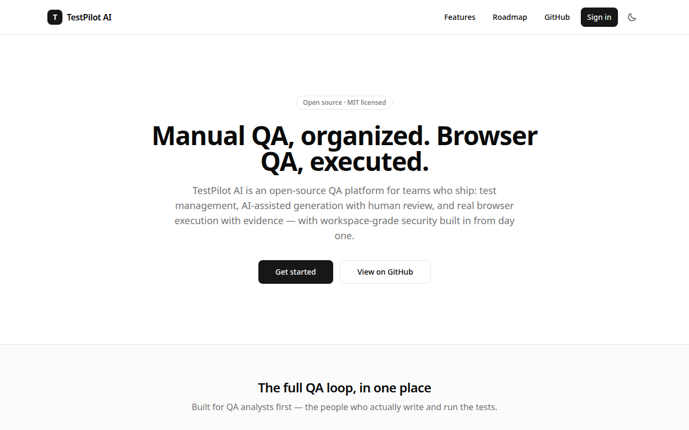
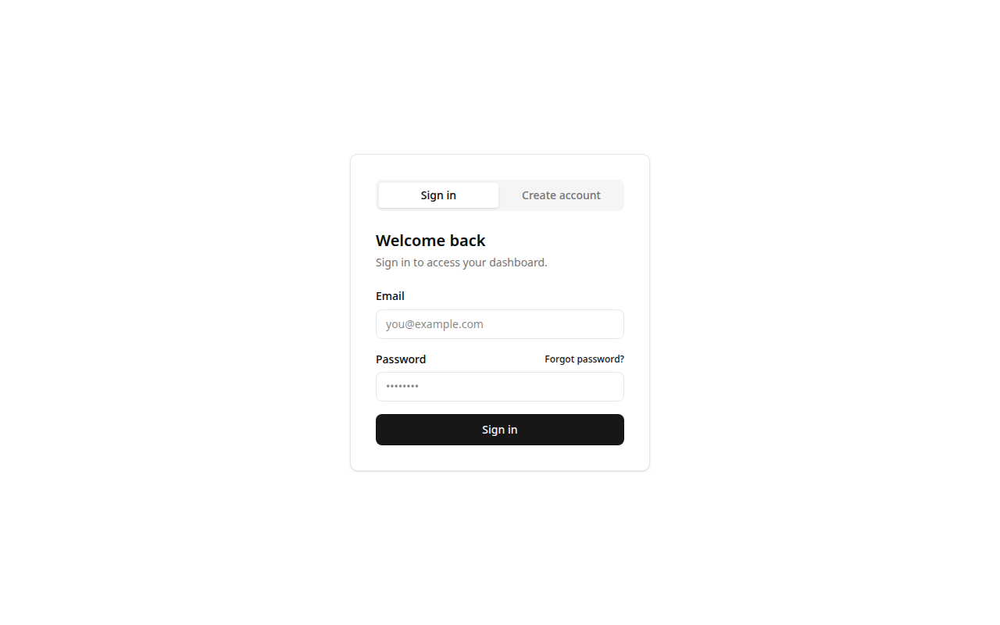

# TestPilot AI

[](https://github.com/aliarslangujjar/TestPilot-AI/actions/workflows/ci.yml)
[](LICENSE.md)

Open-source AI-powered QA SaaS.

> **Status: public beta (v0.1.0-beta.1).** Projects, test management,
> manual and automated execution, AI-assisted generation/review/analysis,
> public QA reports, and a community template library are implemented
> and covered by a 590+ test suite. The beta is a **source release** —
> you self-host it; no hosted instance exists yet. Read
> [docs/KNOWN_LIMITATIONS.md](docs/KNOWN_LIMITATIONS.md) before
> evaluating, and [docs/BETA_RELEASE_CHECKLIST.md](docs/BETA_RELEASE_CHECKLIST.md)
> for the acceptance evidence and remaining blockers.

## Stack

| Layer      | Choice                                                           |
| ---------- | ---------------------------------------------------------------- |
| Web app    | Next.js 16 (App Router) + React 19 + TypeScript (strict)         |
| Styling    | Tailwind CSS v4 + shadcn/ui (new-york theme tokens, `cn()` util) |
| Validation | zod v4 shared schemas in `packages/schemas`                      |
| Database   | Supabase (PostgreSQL) — migrations in `supabase/migrations`      |
| Test runs  | Playwright worker — `workers/playwright`                         |
| Quality    | ESLint (Next.js plugin) + Prettier + `tsc --noEmit` + Vitest     |

## Screenshots

Captured from the production build — the landing page and the sign-in /
create-account form. (Dashboard screenshots need a live Supabase stack;
see the demo options below to explore the app itself.)





## Repository layout

```
app/                    Next.js App Router web app
components/             UI components (shadcn/ui primitives in components/ui)
lib/                    server logic: auth, workspaces, AI service, runs, reports, usage
packages/schemas/      shared zod schemas (via @schemas/* alias)
workers/playwright/    Playwright test-execution worker
supabase/migrations/   versioned database migrations
tests/                  Vitest suites, incl. tests/release (release-readiness scenarios)
examples/demo-app/     sample app + browser plan to try the worker against
docs/                   project documentation
```

One `package.json` and one `package-lock.json` at the root — no duplicate
manifests or lockfiles by design.

## Setup

Prerequisites: Node.js ≥ 20.9 and npm.

```bash
git clone https://github.com/aliarslangujjar/TestPilot-AI.git
cd TestPilot-AI
npm install
cp .env.example .env.local   # fill in values locally; never commit them
npm run dev                  # http://localhost:3000
```

The app needs a Supabase project for auth and data. For local
development use the Supabase CLI's local stack (`supabase start`) and
copy its keys into `.env.local` — [CONTRIBUTING.md](CONTRIBUTING.md)
documents the exact key mapping (Publishable → anon key, Secret →
service-role key).

## Scripts

| Script                 | Purpose                                             |
| ---------------------- | --------------------------------------------------- |
| `npm run dev`          | Start the local dev server                          |
| `npm run build`        | Production build                                    |
| `npm run start`        | Serve the production build                          |
| `npm run lint`         | ESLint check                                        |
| `npm run lint:fix`     | ESLint with auto-fix                                |
| `npm run format`       | Prettier write                                      |
| `npm run format:check` | Prettier check                                      |
| `npm run typecheck`    | TypeScript check (`tsc --noEmit`)                   |
| `npm run test`         | Vitest (single run)                                 |
| `npm run test:release` | Release-readiness scenarios only (`tests/release`)  |
| `npm run worker:e2e`   | Worker staging check against the loopback demo app  |
| `npm run verify`       | Runs typecheck → lint → format:check → test → build |

A fresh clone should pass `npm run verify` end to end.

## Environment

`.env.example` lists every variable name the project expects — copy it to
`.env.local` and fill in values locally. Real secrets are never committed
(enforced by `.gitignore`).

## Try it without an AI key

- **Demo mode:** set `AI_DEMO_MODE=true` in `.env.local` and the AI
  features return locally generated sample output — no API key, no
  paid calls.
- **Sample app:** `examples/demo-app/` is a tiny sign-in web app plus
  a ready-made browser plan, so the Playwright worker has something
  safe to test. It is guarded by the release suite, so it cannot rot
  silently. See [examples/demo-app/README.md](examples/demo-app/README.md).

## Deployment

The web app is designed to deploy to **Vercel** with a **Supabase**
cloud project as the data plane; the Playwright worker runs on a
separate host. **It is not deployed yet** — creating the cloud
projects is an owner step, and [docs/DEPLOYMENT.md](docs/DEPLOYMENT.md)
carries the dated, honest status next to the runbook. See
[docs/DEPLOYMENT.md](docs/DEPLOYMENT.md) for the per-environment
variable matrix, the Supabase/Vercel setup runbook (migrations, auth
redirects, callbacks), the security checklist, health checks
(`/api/health`) and error reporting, and the current deployment
status.

## Contributing

See [CONTRIBUTING.md](CONTRIBUTING.md) for setup, testing, branching,
and pull-request guidance (including good-first-issue pointers) — the
short version:

- TypeScript strict mode; no `any` without justification.
- Conventional Commits (`feat:`, `fix:`, `chore:`, `docs:` …).
- Run `npm run verify` before opening a PR.

Participation is governed by the [Code of Conduct](CODE_OF_CONDUCT.md).
Security issues: report privately — see [SECURITY.md](SECURITY.md),
never a public issue.

## License

MIT — see [LICENSE.md](LICENSE.md). Third-party packages and their
licenses are listed in [THIRD_PARTY_NOTICES.md](THIRD_PARTY_NOTICES.md).
